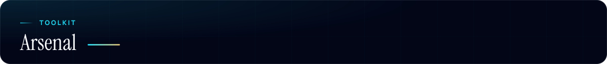
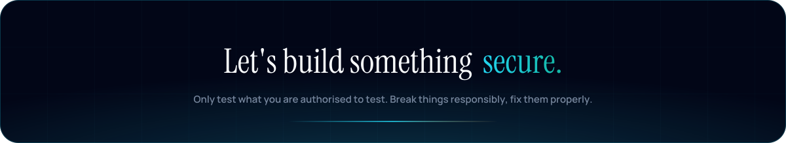

<!-- Artwork in ./assets is generated in the portfolio's own fonts and colours (Instrument Serif, Manrope, #020617 / #22d3ee / #d6b56d). -->
<p align="center">
  <a href="https://sheikhmujtaba.me">
    
  </a>
</p>

<p align="center">
  <a href="https://sheikhmujtaba.me">
    
  </a>
</p>

<p align="center">
  <a href="https://sheikhmujtaba.me"></a>
  <a href="https://sheikhmujtaba.me/blog"></a>
  <a href="https://www.linkedin.com/in/sheikhmujtaba/"></a>
  <a href="https://x.com/Mujtaba_Javed_"></a>
  <a href="https://medium.com/@smujtabaja"></a>
  <a href="mailto:smujtabaja@gmail.com"></a>
</p>
<p align="center">
  <a href="https://discord.gg/mr_ano"></a>
  <a href="https://sheikhmujtaba.me/rss.xml"></a>
</p>


```console
mujtaba@sec-ops:~$ whoami
sheikh_mujtaba  (aka Mujtaba Javed)  ::  ai security engineer + ai developer

mujtaba@sec-ops:~$ cat focus.txt
[+] red-teaming LLM applications and AI agents (prompt injection, tool abuse, data leakage)
[+] securing MCP servers, RAG pipelines and agentic workflows
[+] building production agentic AI: FastAPI, Next.js, Qdrant, human-in-the-loop control
[+] ERPNext / Frappe automation and hardening

mujtaba@sec-ops:~$ cat status.txt
>> web app developer & it consultant @ Tech Accuracy
>> available for remote AI security + AI development work  ::  based in Pakistan (UTC+5)
```


<table>
  <tr>
    <td width="50%" valign="top">
      <h3><a href="https://github.com/Sheikh-Muhammad-Mujtaba/ErpNextGuard">NextGuard</a></h3>
      <p>Backend hardening for Frappe / ERPNext. Blocks malicious <b>Server Scripts</b> at save-time and execution-time.</p>
      
      
      
    </td>
    <td width="50%" valign="top">
      <h3><a href="https://github.com/Sheikh-Muhammad-Mujtaba/ERP_Next-MCP">ERPNext MCP Server</a></h3>
      <p>Model Context Protocol server giving LLM agents doctype-agnostic ERPNext access, gated by <b>permission controls</b> and <b>audit logging</b>.</p>
      
      
      
    </td>
  </tr>
  <tr>
    <td width="50%" valign="top">
      <h3><a href="https://github.com/Sheikh-Muhammad-Mujtaba/AI-Employee-Digital-FTE">AI Employee (Digital FTE)</a></h3>
      <p>An autonomous AI employee powered by Claude Code, Playwright and ERPNext, with human-in-the-loop approvals.</p>
      
      
      
    </td>
    <td width="50%" valign="top">
      <h3><a href="https://github.com/Sheikh-Muhammad-Mujtaba/CRM-Digital-FTE">CRM Digital FTE</a></h3>
      <p>Enterprise-grade AI customer-success platform using Gemini 2.5 Flash and the OpenAI Agents SDK for autonomous multi-channel support, with human-in-the-loop escalation.</p>
      
      
      
    </td>
  </tr>
  <tr>
    <td width="50%" valign="top">
      <h3><a href="https://github.com/Sheikh-Muhammad-Mujtaba/Physical-AI-Humanoid-Robotics-Textbook">Physical AI Textbook + RAG</a></h3>
      <p>Hackathon build: a Physical AI &amp; Humanoid Robotics textbook with a RAG chatbot backed by FastAPI and Qdrant.</p>
      
      
      
    </td>
    <td width="50%" valign="top">
      <h3><a href="https://github.com/Sheikh-Muhammad-Mujtaba/SecuScan">SecuScan</a></h3>
      <p>Website security analyser: SSL certificate checks, security-header checks, Shodan exposure analysis and WHOIS lookups.</p>
      
      
    </td>
  </tr>
</table>

<p align="center"><a href="https://sheikhmujtaba.me/#projects"><b>See every shipped build on the portfolio &rarr;</b></a></p>


<!-- Updated daily by .github/workflows/blog-posts.yml from https://sheikhmujtaba.me/rss.xml -->
<!-- BLOG-POST-LIST:START -->- [Broken Access Control in a Cloud API: How One Missing Check Leaked a Secret &lpar;CTF Walkthrough&rpar;](https://medium.com/@smujtabaja/broken-access-control-in-a-cloud-api-how-one-missing-check-leaked-a-secret-ctf-walkthrough-44b007c4a629?source=rss-d2a7e3027df8------2)
- [What Is an AI Security Engineer? Role &amp; Skills &lpar;2026&rpar;](https://sheikhmujtaba.me/blog/ai-security-engineer)
- [Prompt Injection Attacks: How They Work and How to Defend](https://sheikhmujtaba.me/blog/prompt-injection)
- [OWASP Top 10 for LLM Applications &lpar;2025&rpar;, Explained](https://sheikhmujtaba.me/blog/owasp-top-10-for-llm-applications)
- [AI Red Teaming: A Step-by-Step Methodology for LLM Apps](https://sheikhmujtaba.me/blog/ai-red-teaming)
<!-- BLOG-POST-LIST:END -->



<p align="center">
  <b>Build</b><br/><br/>
  
</p>

<p align="center">
  <b>AI</b><br/><br/>
  
  
  
  
  
  
  
</p>

<p align="center">
  <b>Offensive &amp; defensive security</b><br/><br/>
  <br/><br/>
  
  
  
  
  
  
</p>


<p align="center">
  
  
</p>
<p align="center">
  
</p>

<!-- Generated daily by .github/workflows/snake.yml onto the `output` branch -->
<p align="center">
  <picture>
    <source media="(prefers-color-scheme: dark)" srcset="https://raw.githubusercontent.com/Sheikh-Muhammad-Mujtaba/Sheikh-Muhammad-Mujtaba/output/github-snake-dark.svg" />
    <source media="(prefers-color-scheme: light)" srcset="https://raw.githubusercontent.com/Sheikh-Muhammad-Mujtaba/Sheikh-Muhammad-Mujtaba/output/github-snake.svg" />
    
  </picture>
</p>

<p align="center">
  
</p>

<p align="center">
  <a href="https://sheikhmujtaba.me"></a>
</p>
